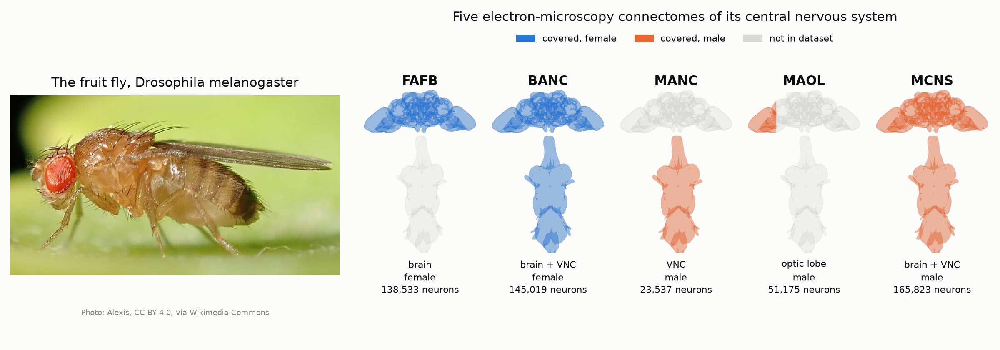
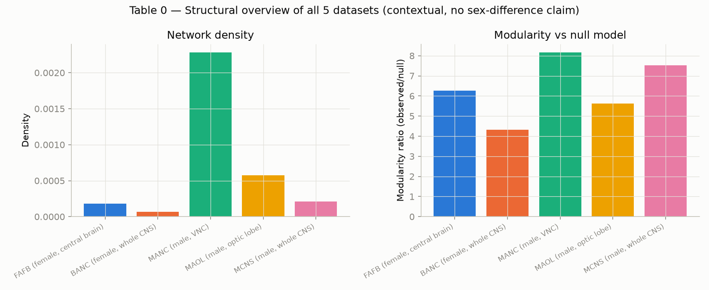

# FlyConnectome Compare

**A network-science comparison of the five *Drosophila* connectomes on FlyWire Codex (FAFB, BANC, MANC, MAOL, MCNS), using shared preprocessing and scope-matched pairs.**

Five complete wiring maps of the fruit fly nervous system, reconstructed from electron microscopy, are now
distributed in the same schema. Their cell-type vocabularies, synapse thresholds and covered regions differ,
though, so comparing them directly can mislead. This study maps class names onto one classification,
filters edges with a common 5-synapse threshold, and normalises modularity and rich-club measures against
degree-preserving null models. In-depth comparisons are run only on the two pairs whose coverage matches.



*Left: the fruit fly. Right: which part of its central nervous system each dataset covers (blue = female, orange = male) and how many neurons enter the analysis. The outline is a common template (male CNS, via `flybrains`); the MAOL panel shades one optic lobe schematically.*

## Overview

| | |
|---|---|
| **Problem** | The same species now has several connectomes, but their network statistics have never been compared with shared preprocessing. It is unclear whether an observed difference comes from biology or from the reconstruction. |
| **Method** | Common neuron schema and Super Class taxonomy, `syn_count ≥ 5` filter, Louvain modularity and rich-club coefficient as ratios to degree-preserving null graphs. Axis 1 compares BANC with MCNS (female / male whole CNS); Axis 2 compares the FAFB optic lobe with MAOL. Axis 2 also matches cell-type names and computes Spearman ρ. |
| **Simulation / hardware** | No simulation; open data from [FlyWire Codex](https://codex.flywire.ai) (~200 MB). Null models were computed on a 28-core Ubuntu machine with 31 GB RAM (noron). |
| **Paper** | In preparation (draft written, not yet submitted to a journal). |

### System architecture


The loaders turn all five datasets, including FAFB's split files, into the same neuron table. The taxonomy
layer maps the Super Classes that each dataset names differently (e.g. BANC `central_brain_intrinsic` and MCNS
`cb_intrinsic`) onto one classification. Unclassified (`_tbc`) labels are not forced into a real class.

## Selected results

### Result 1: Both whole-CNS networks are far more modular than their null models

BANC's modularity is 0.758 against a null mean of 0.176 (ratio 4.3×). For MCNS the values are 0.716 and 0.095
(ratio 7.5×). Raw modularity is higher in BANC, but relative to its own null MCNS has the stronger community
structure. Across the five datasets the ratio ranges from 4.3× to 8.2× and rises with mean degree.


### Result 2: MCNS's extra connectivity sits in the visual system, so it is not a sex difference

At the same threshold MCNS has 4.2 times as many edges as BANC (density ratio 3.19×). The gap is 5.5–7.0× in
the visual classes but only 2.3–2.6× in ventral nerve cord intrinsic and descending neurons. This pattern
points to uneven reconstruction completeness rather than a biological sex difference.


### Result 3: Hub neurons are less interconnected than expected; optic lobe types agree across two datasets

Left: in both networks, high-degree neurons connect to each other far less often than in the null model
(an anti-rich-club pattern). Right: neuron counts of the 266 optic lobe cell types shared by FAFB and MAOL
agree closely (Spearman ρ = 0.96). Total synapse counts agree less (ρ = 0.80). The outlier types cluster in
the "Li" (lobula intrinsic) neurons, the family that is hardest to classify.

<table><tr>
<td></td>
<td></td>
</tr></table>

### Result 4: The finding is robust to the threshold choice

For synapse thresholds of 3, 5 and 10, the modularity ratio stays higher in MCNS than in BANC every time.
Raising the number of null-model repetitions from 3 to 15 does not change the result either.


### Context: structural summary of the five datasets

Density and modularity ratio (observed / null) of each dataset. This table gives context only and makes no sex-difference claim.



*All figures are in `plots/`; the numbers come from `outputs/tables/*.csv`.*

## Installation

### Requirements

- Python ≥ 3.10; runs on Windows and Linux
- An ordinary laptop is enough for the loaders and Axis 2
- Axis 1 and Table 0 build null models on graphs with millions of edges. A local PC ran out of memory; the analysis was completed on a 31 GB RAM Linux machine (with swap).
- No GPU needed

### Steps

```bash
git clone https://github.com/BalBaZeuR0/FlyTracker.git
cd FlyTracker
python3 -m venv .venv && source .venv/bin/activate
pip install -e ".[dev]"
python -m pytest -q          # installation check (after downloading data/)
```

Expected output:

```
24 passed, 5 warnings in 57.45s
```

Data: download the files by hand from each dataset's download page on [codex.flywire.ai](https://codex.flywire.ai)
and put them under `data/<dataset>/`. BANC, MANC, MAOL and MCNS need `neurons.csv.gz` and
`connections_princeton.csv.gz`. FAFB needs `connections_princeton`, `classification`,
`consolidated_cell_types`, `names`, `processed_labels` and `visual_neuron_types` (`.csv.gz`).
The Synapse Table and skeleton files are not needed.

## Usage

```bash
python scripts/run_table0.py                          # 5 datasets, structural summary
python scripts/run_axis1.py --n-randomizations 3      # BANC vs MCNS
python scripts/run_axis2.py                           # FAFB optic lobe vs MAOL
```

Expected output (`outputs/tables/table0_overview.csv`, summary):

```
dataset  n_neurons  n_edges    density   modularity  null_mean  ratio
fafb     138533     3431775    0.000179  0.703       0.112      6.27
banc     145019     1382517    0.000066  0.758       0.176      4.32
manc      23537     1265433    0.002284  0.629       0.077      8.17
maol      51175     1509056    0.000576  0.595       0.106      5.62
mcns     165823     5771540    0.000210  0.716       0.095      7.52
```

`run_axis2.py` also prints the coverage values (Jaccard 0.24; 266 shared types) and the `Synapse-total Spearman rho` value.

## Reproducing the results

| Figure | Command |
|---|---|
| `assets/hero.png` | `pip install -e ".[hero]" && python scripts/make_hero.py` |
| `table0_overview.png`, `table0_rich_club.png` | `python scripts/run_table0.py` |
| `axis1_rich_club.png`, `axis1_class_ratio.png`, `axis1_class_breakdown.png`, `axis1_degree_distribution.png` | `python scripts/run_axis1.py --n-randomizations 3` |
| `axis1_modularity_headline.png`, `axis1_sensitivity.png` | `python scripts/plot_axis1_extra.py` (threshold runs: `run_axis1.py --min-syn-count 3` / `10`) |
| `axis2_type_count_scatter.png` and the other `axis2_*` | `python scripts/run_axis2.py` |
| All figures, from the saved CSVs (without rerunning the null models) | `python scripts/regen_english_figures.py` |
| `assets/architecture.png` | `python scripts/flowchart.py assets/architecture.json` |

Figures are written to `outputs/figures/`; the README copies live in `plots/` and `assets/`.

## Project structure

```
FlyTracker/
├── assets/              # README images (hero.png + fruit_fly_photo.jpg, architecture.png + .json source)
├── data/                # Codex downloads (not committed, ~200 MB)
├── outputs/             # tables/ (CSV) and figures/ (PNG) (not committed)
├── plots/               # README result figures
├── scripts/             # run_table0 / run_axis1 / run_axis2, figure scripts, make_hero.py, flowchart.py
├── src/flyconnectome_compare/
│   ├── io/loaders.py    # 5 datasets → common neuron schema
│   ├── taxonomy.py      # maps Super Class names onto one classification
│   ├── graph/           # graph building, modularity, rich-club, null models
│   ├── compare/         # table0_overview, axis1_sex_cns, axis2_reconstruction
│   └── viz.py           # shared figure style
├── tests/
├── pyproject.toml
└── README.md
```

## Citation, license, contact

```bibtex
@misc{flyconnectomecompare2026,
  title  = {Scope-Matched Network Comparison of Five Drosophila Connectomes},
  author = {Öztürk, Emir},
  year   = {2026},
  howpublished = {\url{https://github.com/BalBaZeuR0/FlyTracker}}
}
```

Data: FlyWire Codex (FAFB, BANC, MANC, MAOL, MCNS). Each dataset's citation terms are listed on its Codex page.
CNS outline: [flybrains](https://github.com/navis-org/navis-flybrains) template meshes.
Fruit fly photo: "Drosophila melanogaster 53362116" by Alexis, [CC BY 4.0](https://creativecommons.org/licenses/by/4.0/), via [Wikimedia Commons](https://commons.wikimedia.org/wiki/File:Drosophila_melanogaster_53362116.jpg) (cropped).
No license file has been added yet; please get in touch before reusing the code.
Contact: [@BalBaZeuR0](https://github.com/BalBaZeuR0), MTA Artificial Intelligence Center.
