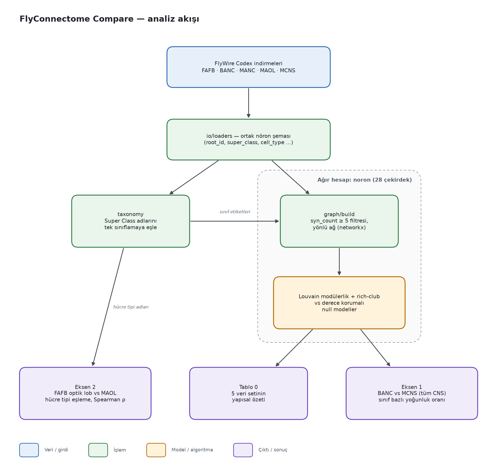
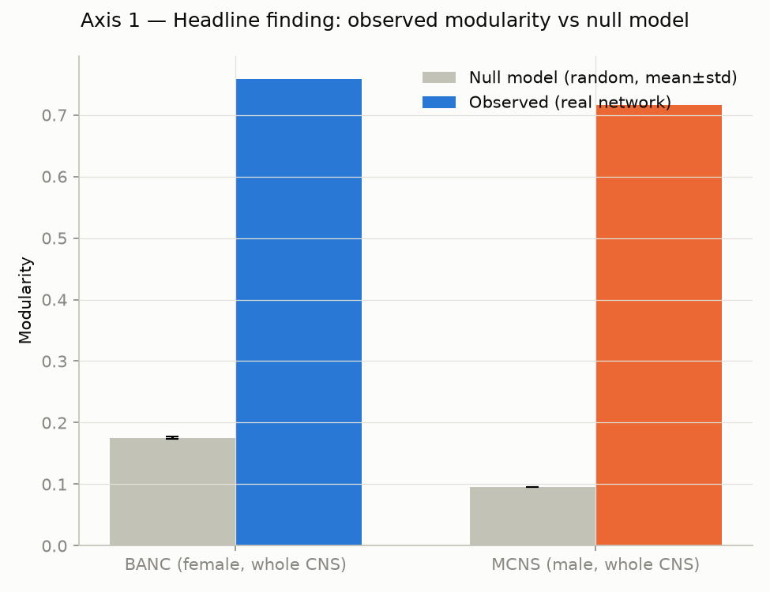
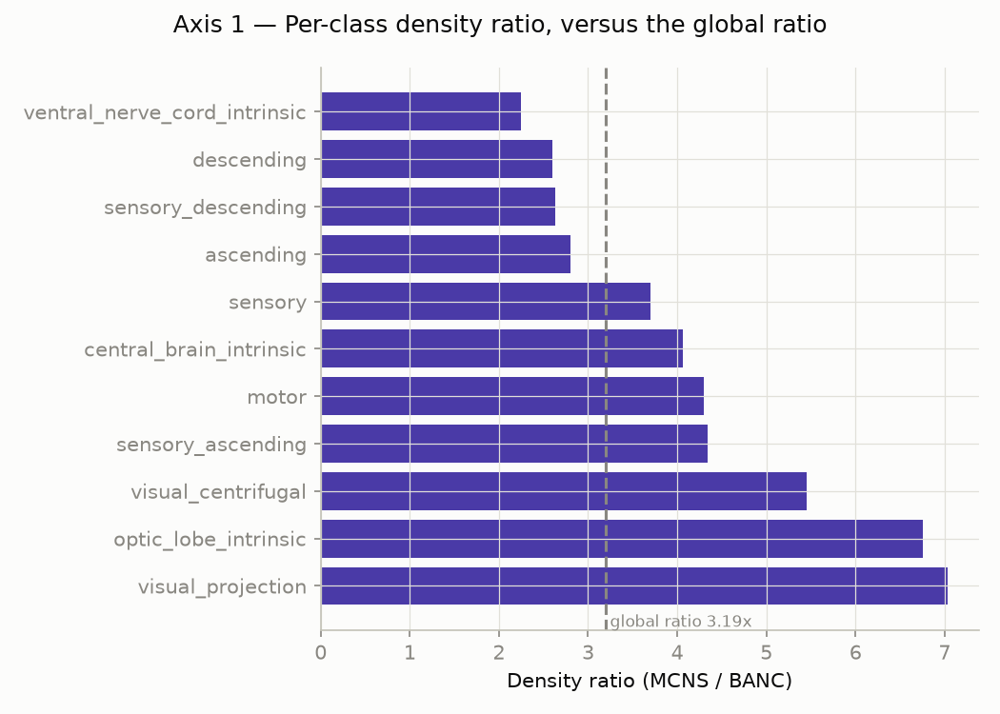
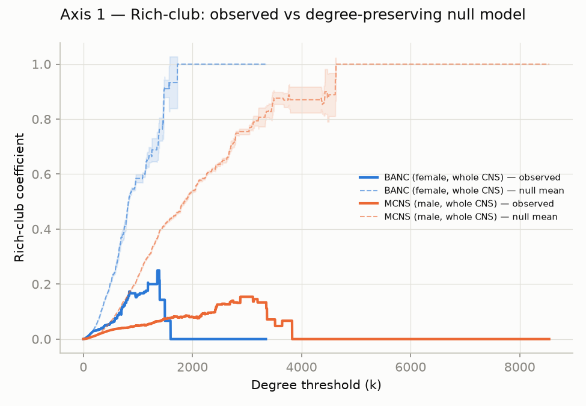
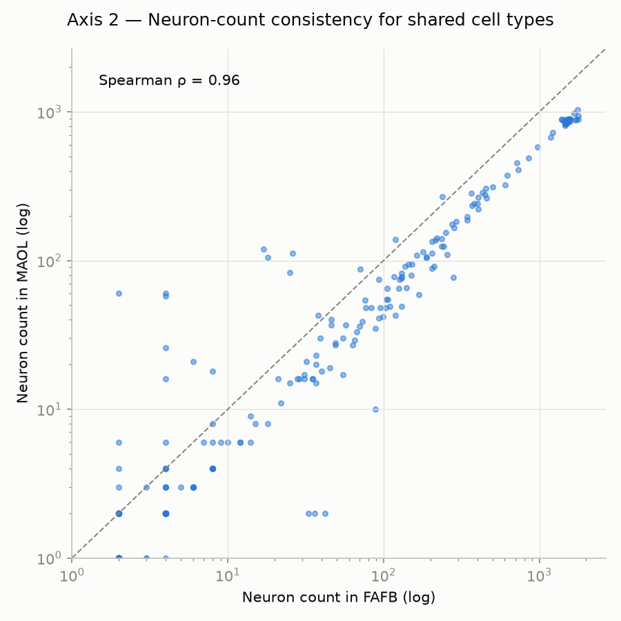
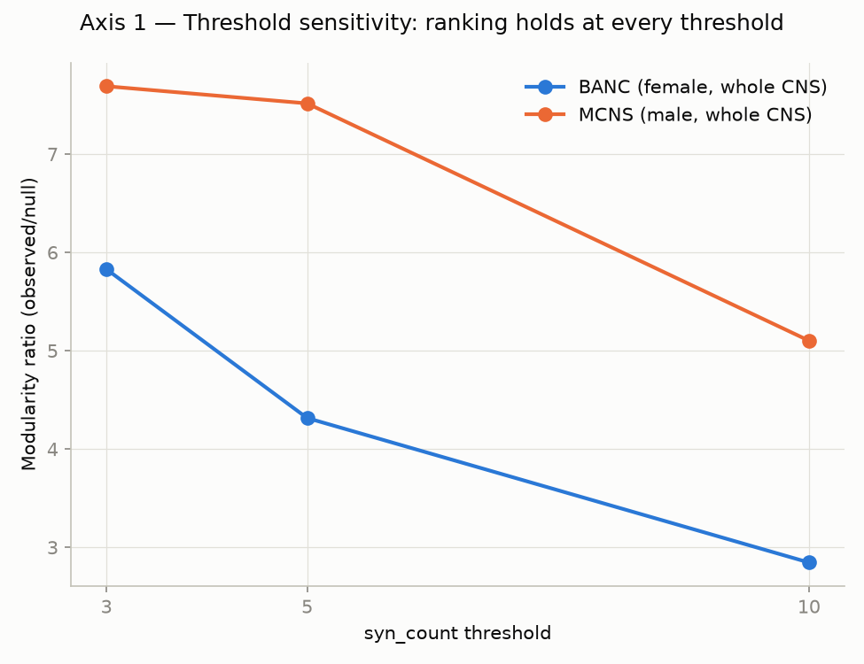

# FlyConnectome Compare

**FlyWire Codex'teki beş Drosophila connectome'unu (FAFB, BANC, MANC, MAOL, MCNS) ortak ön işleme ve kapsamı eşleştirilmiş çiftlerle karşılaştıran ağ bilimi çalışması.**

Meyve sineğinin elektron mikroskobu ile çıkarılmış beş tam bağlantı haritası artık aynı şemayla dağıtılıyor.
Ancak hücre tipi sözlükleri, sinaps eşikleri ve kapsanan bölgeler farklı olduğu için doğrudan
karşılaştırma yanıltıcı olabilir. Bu çalışma sınıf adlarını tek sınıflamaya eşler, kenarları ortak
5-sinaps eşiğiyle süzer ve modülerlik ile rich-club ölçümlerini derece korumalı null modellere göre normalize eder.
Derin karşılaştırmalar yalnızca kapsamı eşleşen iki çift üzerinde yapılır.


*Tablo 0: beş veri setinin yoğunluğu ve null modele göre modülerlik oranı (gözlenen / null). Bu tablo bağlamsaldır, cinsiyet farkı iddiası taşımaz.*

## Özet

| | |
|---|---|
| **Problem** | Aynı türün birden çok connectome'u var, ama ağ istatistikleri ortak ön işlemeyle hiç karşılaştırılmamış. Gözlenen farkın biyolojiden mi, rekonstrüksiyondan mı geldiği ayırt edilemiyor. |
| **Yöntem** | Ortak nöron şeması ve Super Class sınıflaması, `syn_count ≥ 5` filtresi, Louvain modülerlik ve rich-club katsayısının derece korumalı null ağlarla oranı. Eksen 1'de BANC ile MCNS (dişi / erkek tüm CNS) karşılaştırılıyor, Eksen 2'de FAFB optik lobu ile MAOL. Eksen 2'de hücre tipi adları eşleştirilip Spearman ρ hesaplanıyor. |
| **Simülasyon / donanım** | Simülasyon yok; açık veri [FlyWire Codex](https://codex.flywire.ai) (~200 MB). Null modeller 28 çekirdekli, 31 GB RAM'li Ubuntu makinede (noron) hesaplandı. |
| **Makale** | Hazırlanıyor (taslak yazıldı, henüz bir dergiye gönderilmedi). |

### Sistem mimarisi



Yükleyiciler, FAFB'nin parçalı dosyaları dahil beş veri setini aynı nöron tablosuna çevirir. Taksonomi
katmanı her veri setinin farklı adlandırdığı Super Class'ları (ör. BANC `central_brain_intrinsic` ve MCNS
`cb_intrinsic`) tek sınıflamaya eşler. Sınıflandırılmamış (`_tbc`) etiketler gerçek bir sınıfa zorla katılmaz.

## Seçilmiş sonuçlar

### Sonuç 1: Her iki tüm-CNS ağı da null modelden çok daha modüler

BANC'ın modülerliği 0,758, null ortalaması 0,176 (oran 4,3×). MCNS'te bu değerler 0,716 ve 0,095 (oran 7,5×).
Ham modülerlik BANC'ta daha yüksek, ama kendi null'una göre MCNS'in topluluk yapısı daha güçlü. Beş veri
setinde oran 4,3–8,2× arasında değişiyor ve ortalama dereceyle birlikte artıyor.



### Sonuç 2: MCNS'in fazla bağlantısı görsel sistemde toplanıyor, yani bu bir cinsiyet farkı değil

Aynı eşikte MCNS'te BANC'ın 4,2 katı kenar var (yoğunluk oranı 3,19×). Fark görsel sınıflarda 5,5–7,0×
iken sinir kordonu iç nöronlarında ve inen nöronlarda yalnızca 2,3–2,6×. Bu dağılım biyolojik cinsiyet
farkından çok, rekonstrüksiyon tamlığındaki eşitsizliğe işaret ediyor.



### Sonuç 3: Hub nöronlar beklenenden az birbirine bağlı; optik lob tipleri iki veri setinde tutarlı

Solda: iki ağda da yüksek dereceli nöronların birbirine bağlanma oranı null modelin çok altında (rich-club
karşıtı örüntü). Sağda: FAFB ile MAOL'de ortak 266 optik lob hücre tipinin nöron sayıları çok tutarlı
(Spearman ρ = 0,96). Toplam sinaps sayıları daha az tutarlı (ρ = 0,80). Aykırı tipler, sınıflandırması en zor
aile olan "Li" (lobula iç) nöronlarında toplanıyor.

<table><tr>
<td></td>
<td></td>
</tr></table>

### Sonuç 4: Bulgu eşik seçimine dayanıklı

Sinaps eşiği 3, 5 ve 10 için modülerlik oranı her durumda MCNS'te BANC'tan yüksek kalıyor. Null model tekrar sayısını 3'ten 15'e çıkarmak da sonucu değiştirmiyor.



*Tüm şekiller `plots/` klasöründe; sayıların kaynağı `outputs/tables/*.csv`.*

## Kurulum

### Gereksinimler

- Python ≥ 3.10; Windows ve Linux'ta çalışır
- Yükleyiciler ve Eksen 2 için sıradan bir dizüstü yeterli
- Eksen 1 ve Tablo 0, milyonlarca kenarlı ağlarda null model kurar. Yerel PC'de bellek yetmedi; analiz 31 GB RAM'li Linux makinede (swap ile) tamamlandı.
- GPU gerekmez

### Adımlar

```bash
git clone https://github.com/BalBaZeuR0/FlyTracker.git
cd FlyTracker
python3 -m venv .venv && source .venv/bin/activate
pip install -e ".[dev]"
python -m pytest -q          # kurulum kontrolü (data/ indirildikten sonra)
```

Beklenen çıktı:

```
24 passed, 5 warnings in 57.45s
```

Veri: [codex.flywire.ai](https://codex.flywire.ai) üzerinden her veri setinin indirme sayfasından dosyaları
elle indirip `data/<dataset>/` altına koyun. BANC, MANC, MAOL ve MCNS için `neurons.csv.gz` ve
`connections_princeton.csv.gz` gerekir. FAFB için `connections_princeton`, `classification`,
`consolidated_cell_types`, `names`, `processed_labels` ve `visual_neuron_types` (`.csv.gz`) gerekir.
Synapse Table ve skeleton dosyaları gerekmez.

## Kullanım

```bash
python scripts/run_table0.py                          # 5 veri seti, yapısal özet
python scripts/run_axis1.py --n-randomizations 3      # BANC vs MCNS
python scripts/run_axis2.py                           # FAFB optik lob vs MAOL
```

Beklenen çıktı (`outputs/tables/table0_overview.csv`, özet):

```
dataset  n_neurons  n_edges    density   modularity  null_mean  ratio
fafb     138533     3431775    0.000179  0.703       0.112      6.27
banc     145019     1382517    0.000066  0.758       0.176      4.32
manc      23537     1265433    0.002284  0.629       0.077      8.17
maol      51175     1509056    0.000576  0.595       0.106      5.62
mcns     165823     5771540    0.000210  0.716       0.095      7.52
```

`run_axis2.py` ayrıca kapsama değerlerini (Jaccard 0,24; 266 ortak tip) ve `Synapse-total Spearman rho` değerini yazdırır.

## Sonuçları yeniden üretme

| Şekil | Komut |
|---|---|
| `assets/overview.png` (`table0_overview.png`), `table0_rich_club.png` | `python scripts/run_table0.py` |
| `axis1_rich_club.png`, `axis1_class_ratio.png`, `axis1_class_breakdown.png`, `axis1_degree_distribution.png` | `python scripts/run_axis1.py --n-randomizations 3` |
| `axis1_modularity_headline.png`, `axis1_sensitivity.png` | `python scripts/plot_axis1_extra.py` (eşik koşuları: `run_axis1.py --min-syn-count 3` / `10`) |
| `axis2_type_count_scatter.png` ve diğer `axis2_*` | `python scripts/run_axis2.py` |
| Tüm şekiller, kayıtlı CSV'lerden (null modeller yeniden koşulmadan) | `python scripts/regen_english_figures.py` |
| `assets/architecture.png` | `python scripts/flowchart.py assets/architecture.json` |

Şekiller `outputs/figures/` klasörüne yazılır; README kopyaları `plots/` ve `assets/` klasörlerindedir.

## Proje yapısı

```
FlyTracker/
├── assets/              # README görselleri (overview.png, architecture.png + .json kaynağı)
├── data/                # Codex indirmeleri (git'e alınmaz, ~200 MB)
├── outputs/             # tables/ (CSV) ve figures/ (PNG) (git'e alınmaz)
├── plots/               # README sonuç grafikleri
├── scripts/             # run_table0 / run_axis1 / run_axis2, şekil betikleri, flowchart.py
├── src/flyconnectome_compare/
│   ├── io/loaders.py    # 5 veri seti → ortak nöron şeması
│   ├── taxonomy.py      # Super Class adlarının tek sınıflamaya eşlenmesi
│   ├── graph/           # ağ kurma, modülerlik, rich-club, null modeller
│   ├── compare/         # table0_overview, axis1_sex_cns, axis2_reconstruction
│   └── viz.py           # ortak şekil stili
├── tests/
├── pyproject.toml
└── README.md
```

## Atıf, lisans, iletişim

```bibtex
@misc{flyconnectomecompare2026,
  title  = {Scope-Matched Network Comparison of Five Drosophila Connectomes},
  author = {Öztürk, Emir},
  year   = {2026},
  howpublished = {\url{https://github.com/BalBaZeuR0/FlyTracker}}
}
```

Veri: FlyWire Codex (FAFB, BANC, MANC, MAOL, MCNS). Her veri setinin kendi atıf koşulları Codex sayfalarında belirtilmiştir.
Lisans dosyası henüz eklenmedi, kullanım için iletişime geçin.
İletişim: [@BalBaZeuR0](https://github.com/BalBaZeuR0), MTA Yapay Zeka Merkezi.
